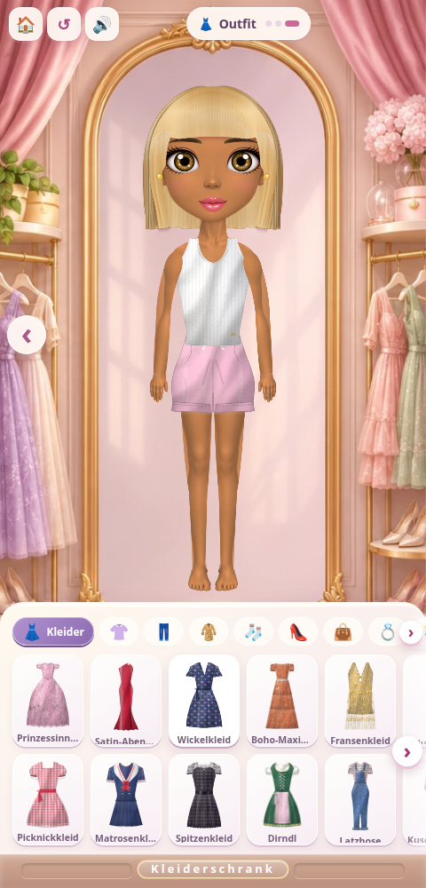
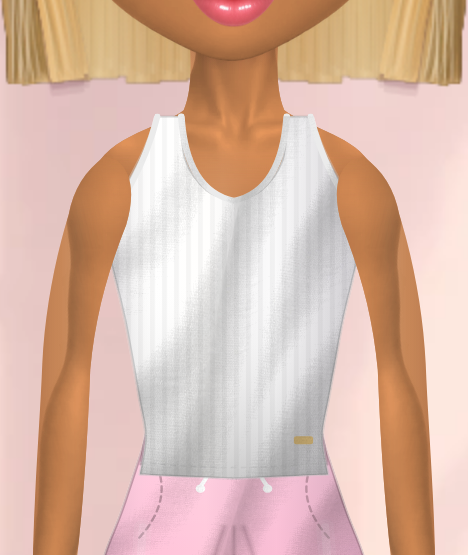
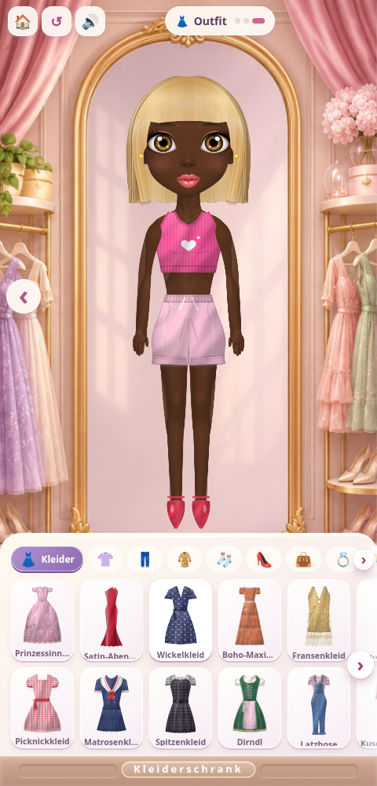

# Modellierte Figur — V6

Hals, Schlüsselbeine und Schultern gehen weich ineinander über. Arme und Beine haben räumliche Lichtwirkung; Hände und Füße zeigen ausgearbeitete Finger und Zehen. Die Bilder stammen direkt aus dem Spiel. Für freie Sicht auf die Schultern wurden die Haare mit der Spielschere gekürzt.

## Ganze Figur

## Hals und Schultern

## Weitere Hautfarbe und Pumps

[Komplettes Repository als ZIP herunterladen](https://github.com/clipstv64-cyber/styling-game/archive/refs/heads/grafik-atelier.zip)
